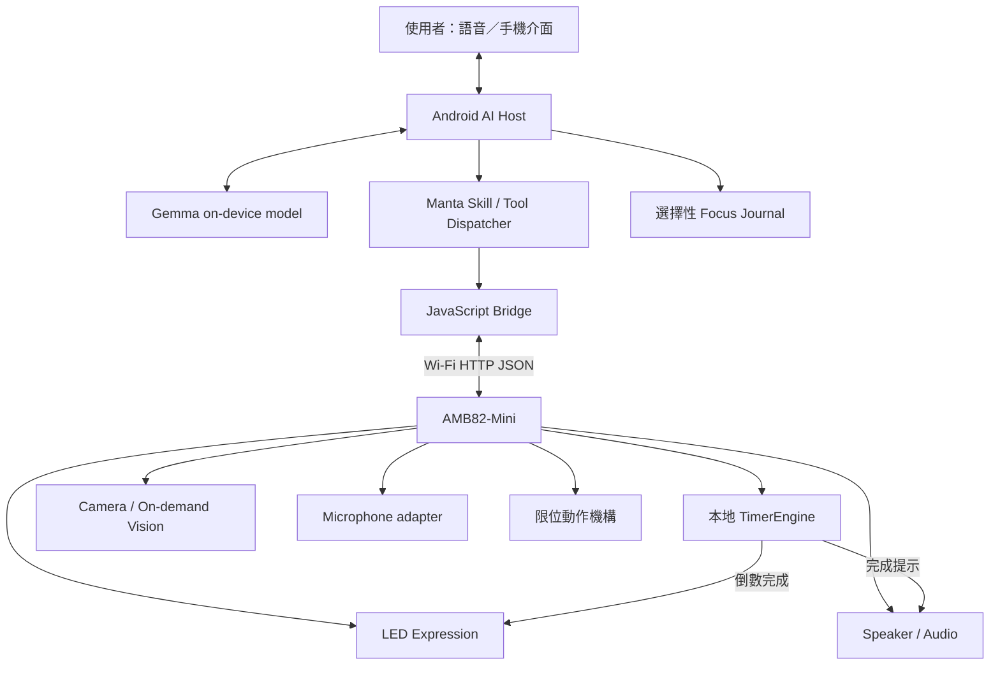
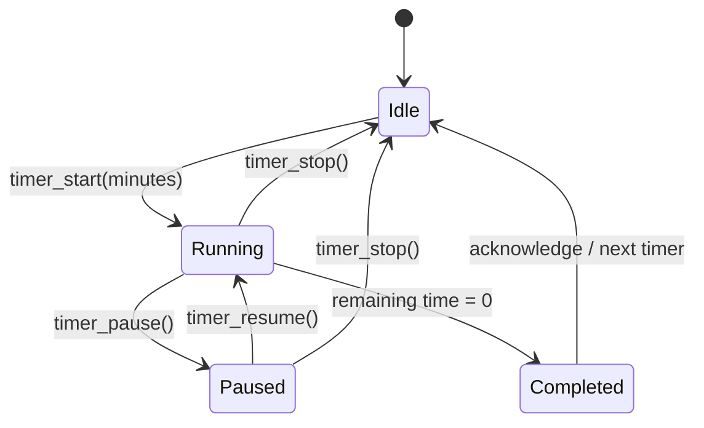

# AI Plush Manta｜系統架構與介面規格

## 1. 系統目標

AI Plush Manta 是以鬼蝠魟為造型的互動式毛絨玩偶。系統將即時、可預期的嵌入式控制與 AI 語言理解分開：

- **Manta plush：** 實體角色外觀，整合感測器與回饋模組。
- **AMB82-Mini：** Wi-Fi、裝置 API、本地計時器及周邊控制。
- **Android AI host：** Gemma 推理、語音介面、意圖理解及工具協調。
- **Manta Skill／JavaScript bridge：** 僅提供經驗證的語意操作，不開放 AI 直接控制任意 GPIO、PWM 或伺服角度。

## 2. 系統總覽




## 3. 實體玩偶與硬體分工

| 模組 | 功能 | 整合狀態 |
|---|---|---|
| Manta plush 外殼 | 深藍背部、白色腹部、寬胸鰭與內部模組固定 | 概念設計 |
| AMB82-Mini（RTL8735B） | 主控制器、Wi-Fi、HTTP API | 參考平台；需確認板型 |
| Camera | 使用者要求時進行單次影像擷取 | 待整合 |
| Microphone | 語音輸入 | 依音訊架構待整合 |
| Speaker／amplifier | 提示音與語音播放 | 待整合 |
| RGB LED | happy、curious、thinking、focus 等表情 | 待整合 |
| Optional actuator | 胸鰭或身體的有限度動作 | 選配；需機構限位 |
| Android phone／tablet | AI 推理、語音與操作介面 | AI host |

所有接線與模組選擇都必須依實際板型確認腳位、電壓、電流預算及函式庫相容性。不要因概念圖畫出某個模組，就假設該模組已經存在或已經完成整合。

## 4. 軟體模組

### 4.1 Embedded firmware
- `NetworkService`：Wi-Fi 連線與 HTTP request handling。
- `DeviceAPI`：`/status`、`/look`、`/emotion`、`/play` 與 Timer endpoints。
- `TimerEngine`：以非阻塞單調時間差計算倒數，支援 idle、running、paused、completed。
- `PerceptionAdapter`：相機擷取與可選的本地辨識。
- `ExpressionAdapter`：LED 表情與可選的限位動作。
- `AudioAdapter`：白名單音效播放。
- `SafetyController`：動作範圍、逾時與失敗安全狀態。

### 4.2 Android AI host
- Gemma 解析自然語言並生成回覆。
- Manta Skill 將使用者意圖轉成核准的語意工具操作。
- JavaScript bridge 驗證參數，再呼叫裝置 HTTP API。
- AI 推理不是計時時鐘的一部分；計時開始後由 AMB82-Mini 獨立倒數。

### 4.3 創新服務
- **FocusFlow：** 手機端專注／休息流程協調，下一階段需使用者確認。
- **CompanionState：** 將明確互動事件映射到 happy、curious、thinking、focus、resting、sleepy 等狀態。
- **BreakCoach：** 計時完成後提供一般休息提醒。
- **FocusJournal：** 手機端選擇性保存完成次數與專注總分鐘數。
- **OnDemandVision：** 僅在使用者請求時擷取單次影像。

## 5. Timer 狀態機




Timer 使用經過時間計算，不依賴反覆呼叫長時間阻塞延遲。暫停時保存剩餘時間；繼續時重新記錄起始時間。歸零時只觸發一次完成回饋。

**限制：** 目前以板子供電期間的單調計時來源運作；重新啟動或斷電後不會自動恢復。未來可評估 RTC 或持久化截止時間。

## 6. HTTP API 合約

所有端點應回傳 JSON 並包含 `ok` 欄位。此參考版本使用 GET 以配合範例 bridge；正式部署時，狀態變更建議改用 POST，並加入裝置端驗證。

| Method | Endpoint | 參數 | 功能 |
|---|---|---|---|
| GET | `/status` | — | 裝置狀態 |
| GET | `/look` | — | 單次按需視覺觀察 |
| GET | `/nod`、`/shake`、`/wave` | — | 預先定義的有限動作 |
| GET | `/stop` | — | 停止目前動作 |
| GET | `/emotion/{value}` | 核准狀態 | 切換角色表情 |
| GET | `/play/{sound}` | 核准音效 ID | 播放白名單音效 |
| GET | `/timer/start?minutes=N` | 整數 1–180 | 開始倒數 |
| GET | `/timer/pause` | — | 暫停 |
| GET | `/timer/resume` | — | 繼續 |
| GET | `/timer/stop` | — | 停止並清除 |
| GET | `/timer/status` | — | 查詢狀態與剩餘秒數 |

範例回應：

```json
{
  "ok": true,
  "timer": {
    "state": "running",
    "remainingSeconds": 1240
  }
}
```

## 7. Agent 工具規格

| Tool | Input | 行為 |
|---|---|---|
| `look` | 無 | 使用者要求時進行單次觀察 |
| `status` | 無 | 查詢裝置狀態 |
| `emotion` | 核准狀態 | 切換表情 |
| `play` | 核准音效 ID | 播放預設音效 |
| `nod`、`shake`、`wave`、`stop` | 無 | 預先定義動作／停止 |
| `timer_start` | `minutes: 1..180` | 開始倒數 |
| `timer_pause` | 無 | 暫停 |
| `timer_resume` | 無 | 繼續 |
| `timer_stop` | 無 | 停止並清除 |
| `timer_status` | 無 | 讀取剩餘時間 |

若「幫我計時一下」等要求沒有明確時間，必須先詢問，不可自行猜測。若目前已有計時正在執行，覆蓋前應確認使用者意圖。

## 8. 隱私、可靠度與安全

- 相機／麥克風不預設持續啟用；啟用時應提供清楚的狀態指示。
- 不預設保存或傳送媒體；Focus Journal 僅保存使用者選擇加入的統計。
- 角色情緒是互動狀態，不宣稱能準確推斷使用者情緒或健康狀況。
- AI 不可傳送任意 GPIO、PWM、伺服角度、檔案路徑或 shell 指令。
- 可動機構必須限制行程、速度與時間，逾時或連線失敗時停止。
- 電源、電池、線材及硬質機構必須固定並與玩偶填充物隔離。
- 計時一旦啟動，即使 AI host 暫時無法使用，TimerEngine 仍應持續運作。
- 本專題屬工程原型，並非已取得安全認證的消費型玩具。

## 9. 開發與驗證順序

1. 確認板型、供電、Wi-Fi 與 `/status`。
2. 不接 AI，先測試 timer start／pause／resume／stop／status。
3. 串接 Skill bridge 並驗證輸入參數。
4. 依硬體規格介接 LED、喇叭與完成提示。
5. 加入按需相機擷取與可選感測器。
6. 測試 Android 語音操作、Wi-Fi 中斷與錯誤復原。
7. 記錄計時誤差、功耗、連線穩定度與互動測試結果。
