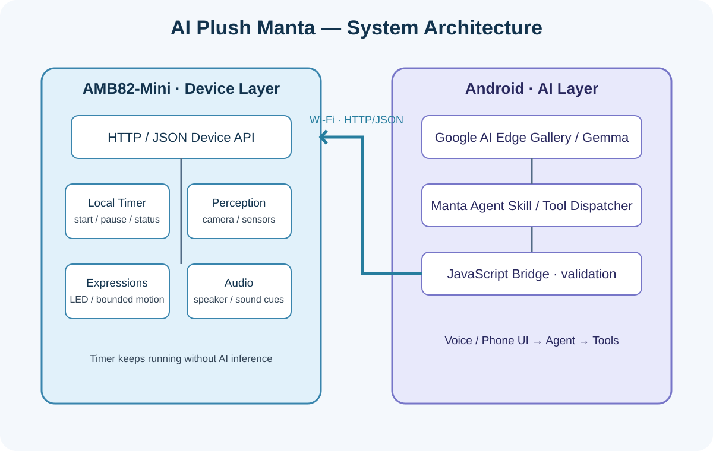
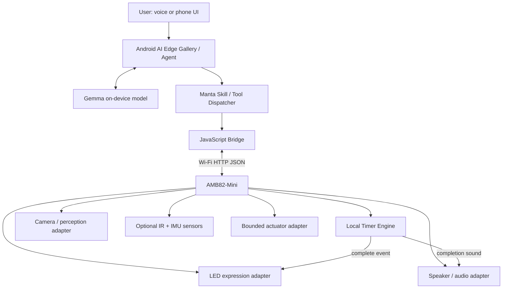
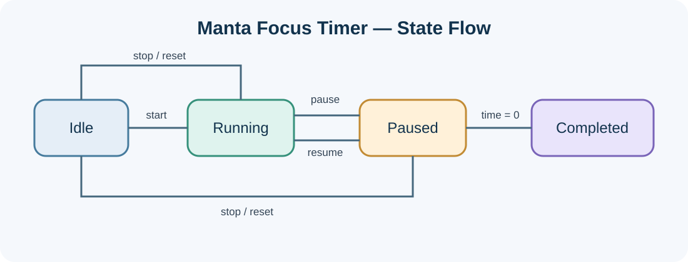
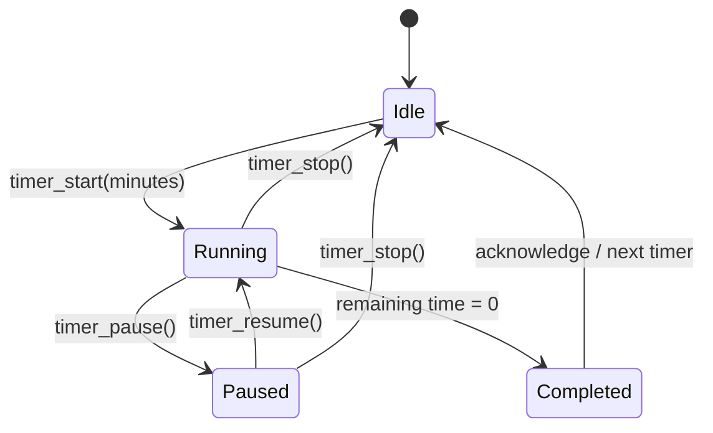

# AI Plush Manta — System Architecture

## 1. Design goal

AI Plush Manta is a manta-ray-shaped interactive plush companion. The architecture separates **deterministic embedded control** from **AI reasoning**:

- **AMB82-Mini:** device connectivity, timer engine, sensor/peripheral adapters, and safe physical actions.
- **Android AI host:** Gemma model inference, conversation, speech interface, and agent/tool orchestration.
- **JavaScript bridge:** validates a small set of semantic actions and calls the device HTTP API.

The microcontroller does not host the large language model. The AI never receives arbitrary GPIO, PWM, servo-angle, or file-system access.

## 2. System architecture





## 3. Hardware responsibilities

| Module | Responsibility | Implementation status |
|---|---|---|
| AMB82-Mini | Main embedded controller and Wi-Fi API | Reference firmware |
| Camera | On-demand image capture / local perception | Adapter placeholder; board-specific integration required |
| Microphone | Voice capture, if supported by chosen audio path | Hardware/app integration required |
| Speaker + amplifier | Sound effects and timer completion notification | Adapter placeholder |
| RGB LED | Happy, curious, thinking, focus, and completion states | Adapter placeholder |
| Optional servo/fin mechanism | Gentle expressive motion | Adapter placeholder; guarded movement only |
| Optional IR / IMU | Proximity, pickup, and tilt events | Optional future integration |
| Android phone/tablet | AI inference, speech, and agent logic | External AI host |

Do not assume every optional peripheral is present. Confirm the exact AMB82-Mini revision, pin mapping, voltage levels, current budget, and supported libraries before wiring.

## 4. Software modules

### 4.1 Embedded firmware
- `NetworkService`: Wi-Fi connection and HTTP request handling.
- `DeviceAPI`: semantic endpoints such as `/look`, `/emotion/happy`, and timer operations.
- `TimerEngine`: non-blocking countdown based on `millis()`; supports running, paused, idle, and completed states.
- `PerceptionAdapter`: camera capture and optional local detection.
- `ExpressionAdapter`: LED patterns and bounded gestures.
- `AudioAdapter`: whitelisted sound playback.
- `SafetyController`: action limits and safe fallback behavior.

### 4.2 Android AI host
- Gemma model performs language understanding and response generation.
- Manta Skill maps natural-language intents to approved semantic actions.
- The JavaScript bridge validates arguments and translates actions to HTTP requests.
- AI inference is not part of the timer clock. A running countdown continues even when the model is busy.

### 4.3 Innovation services\n\n- `FocusFlow`: optional focus/rest cycle coordinator; asks before starting another round.\n- `CompanionState`: maps explicit interaction events to a finite set of states (`happy`, `curious`, `thinking`, `focus`, `resting`, `sleepy`). These are presentation states, not inferred diagnoses.\n- `BreakCoach`: offers a gentle break prompt after a completed session.\n- `FocusJournal` (phone-side, opt-in): stores session count and total focus minutes only; it does not need media or conversation transcripts.\n- `OnDemandVision`: performs a single capture only after a user request or explicit interaction.\n\n## 5. Timer state machine





The timer uses elapsed monotonic milliseconds rather than repeated blocking delays. When paused, the remaining duration is saved. On resume, a new start timestamp is recorded. On completion, the firmware emits a one-shot notification and changes the expression to happy.

**Limit:** a `millis()`-based timer runs while the board remains powered. Persistence across reset or power loss is not included in this prototype; it can be added later using a real-time clock or persisted deadline.

## 6. HTTP API contract

All endpoints return JSON with an `ok` field. The prototype uses GET for compatibility with the original example; a production implementation should use POST for state-changing operations and add authentication.

| Method | Endpoint | Parameters | Result |
|---|---|---|---|
| GET | `/status` | — | Device state |
| GET | `/look` | — | On-demand perception result |
| GET | `/nod`, `/shake`, `/wave` | — | Bounded gesture request |
| GET | `/emotion/{value}` | happy/curious/thinking/sleepy/focus | Set expression |
| GET | `/play/{sound}` | hello/giggle/goodbye/timer_done | Play whitelisted sound |
| GET | `/timer/start?minutes=N` | integer 1–180 | Start countdown |
| GET | `/timer/pause` | — | Pause |
| GET | `/timer/resume` | — | Resume |
| GET | `/timer/stop` | — | Stop and clear |
| GET | `/timer/status` | — | state, remainingSeconds |

Example timer status:

```json
{
  "ok": true,
  "timer": {
    "state": "running",
    "remainingSeconds": 1240
  }
}
```

## 7. Agent tool schema

The agent should expose only these semantic operations:

| Tool | Input | Behavior |
|---|---|---|
| `look` | none | Request one observation when useful |
| `status` | none | Query device health |
| `emotion` | approved emotion | Change expression |
| `play` | approved sound ID | Play a known sound |
| `nod`, `shake`, `wave`, `stop` | none | Bounded gesture / stop |
| `timer_start` | `minutes: 1..180` | Start countdown |
| `timer_pause` | none | Pause |
| `timer_resume` | none | Resume |
| `timer_stop` | none | Clear timer |
| `timer_status` | none | Read remaining time |

For ambiguous requests such as “set a timer for a while,” ask the user for the duration instead of guessing.

## 8. Privacy, reliability, and safety

- Do not continuously capture or upload camera/microphone data by default; vision is on-demand.\n- Treat companion moods as selectable interaction states; do not claim reliable emotion or health inference.\n- Focus history is opt-in and limited to session statistics; provide a clear way to disable and clear it.
- Show a visible indicator whenever camera or microphone capture is active.
- Do not store media by default; provide clear user controls for capture and deletion.
- Keep GPIO/PWM and raw servo values inaccessible to the AI.
- Bound all motion in firmware and stop motion on timeout or connectivity failure.
- Keep batteries, wiring, and rigid mechanisms in a secure enclosure away from the plush surface.
- The timer must be independent of AI availability once started.
- Use a physical power switch and hardware sensor-disable controls where feasible.
- Treat this as an engineering prototype, not a certified consumer toy.

## 9. Implementation sequence

1. Verify board, power, Wi-Fi, and `/status`.
2. Test timer start/pause/resume/stop/status without AI.
3. Connect the Skill bridge and validate tool arguments.
4. Integrate LED and speaker adapters; verify timer completion feedback.
5. Integrate camera and optional sensors on demand.
6. Test Android speech interaction and failure recovery.
7. Document measured latency, runtime, and power consumption.
